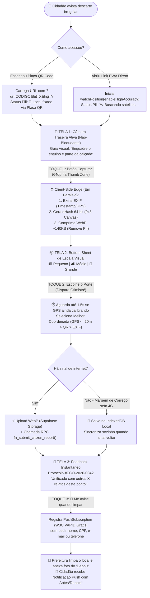

# Entregável 1: Concepção, Funcionalidades e UX Mobile-First (Inversão de Esforço)

> **Skills Acionadas e Explicitadas neste Módulo:**
> - **`mobile-design`**: Filosofia *Mobile-First / Touch-First / Battery-Conscious*, cálculo do **MFRI (Mobile Feasibility & Risk Index)**, aplicação da **Lei de Fitts** (*Thumb Zone* — Zona do Polegar) e alvos de toque $\ge 48\text{dp}$.
> - **`ux-flow`**: Arquitetura de informação com **Divulgação Progressiva (*Progressive Disclosure*)**, **Lei de Hick** (máximo de 3 escolhas por tela), fluxo linear de **3 toques** e tratamento de estados de carregamento/erro/offline.
> - **`product-manager-toolkit`**: Desenho da Proposta de Valor centrado nas Personas validadas (*Marcos — Cidadão Coletor* e *Juliana — Gestora Decisora*) e no Protocolo Mínimo de Observação Científica (Ficha de Desafio 09).
> - **`gdpr-data-handling` (Adaptado à LGPD)**: *Privacy by Design* no dispositivo (*Client-Side Edge*), anonimato nativo sem coleta de PII (CPF, nome, telefone ou e-mail) e expurgo de metadados rastreáveis antes do upload.

---

## 1. O Paradigma da "Inversão de Esforço" no Mobile

As entrevistas de validação conduzidas pela equipe comprovaram que **o cidadão desiste de relatar um ponto de descarte irregular se o processo demorar mais de 30 segundos ou exigir burocracia** (cadastros de ouvidoria 156, senhas, digitação manual de endereço). Por outro lado, fotos enviadas espontaneamente em grupos de WhatsApp **perdem os metadados EXIF de GPS**, tornando o dado inútil para a prefeitura.

A **Inversão de Esforço** transfere 100% da carga cognitiva e de estruturação de dados do cidadão para o dispositivo móvel e o sistema geoespacial:

| Etapa do Registro | Modelo Tradicional (Ouvidoria / 156) | Modelo Redes Sociais (WhatsApp) | Nossa Solução: Inversão de Esforço (PWA) |
| :--- | :--- | :--- | :--- |
| **Acesso ao App** | Baixar na loja (40MB) ou abrir portal lento | Abrir grupo do bairro | **Instantâneo via QR Code na rua ou Link PWA (< 1s)** |
| **Identificação** | Cadastro obrigatório (CPF, Nome, E-mail, Senha) | Expõe número de celular pessoal no grupo | **100% Anônimo (`anonymous_device_hash` + VAPID)** |
| **Localização** | Digitar CEP, Rua, Número e Ponto de Referência | Perdida (WhatsApp remove cabeçalho EXIF) | **Captura Automática Híbrida (GPS Browser + EXIF + QR)** |
| **Classificação** | Escolher entre 25 subcategorias técnicas | Texto livre despadronizado ("Olha que absurdo") | **1 Toque Visual de Porte Logístico (P / M / G)** |
| **Esforço Total** | **12+ interações / 4 a 8 minutos** | **Baixo esforço, mas dado 0% acionável** | **Máximo 3 Toques / < 15 segundos / Dado 100% Estruturado** |

---

## 2. Avaliação Técnica de Viabilidade Mobile (MFRI — Skill `mobile-design`)

Antes de definir as telas, aplicamos o **Mobile Feasibility & Risk Index (MFRI)**:

$$\text{MFRI} = (\text{Platform Clarity} + \text{Accessibility Readiness}) - (\text{Interaction Complexity} + \text{Performance Risk} + \text{Offline Dependence})$$

- **Platform Clarity ($5/5$):** PWA universal rodando em Android (Chrome) e iOS 16.4+ (Safari/WebKit) utilizando APIs padronizadas W3C (`MediaDevices`, `Geolocation`, `IndexedDB`, `ServiceWorker`, `PushManager`).
- **Accessibility Readiness ($4/5$):** Alto contraste (`AAA`) para leitura sob sol forte na calçada, botões de `56px` a `64px` na zona inferior da tela (*Thumb Zone*), ícones semânticos universais e vibração háptica (`navigator.vibrate`).
- **Interaction Complexity ($1/5$):** Zero uso de teclado virtual (*Zero Typing*). Apenas 3 toques sequenciais.
- **Performance Risk ($1/5$):** Processamento de imagem e extração EXIF isolados em `Web Worker` para nunca bloquear a *main thread* (mantendo a UI a `60fps`).
- **Offline Dependence ($1/5$):** Persistência local imediata no `IndexedDB` quando o usuário está em fundos de vale ou margens de córrego sem sinal 4G.

$$\text{MFRI} = (5 + 4) - (1 + 1 + 1) = \mathbf{+6} \quad \implies \quad \text{Status: SAFE (Arquitetura Mobile Validada)}$$

---

## 3. Especificação das Features Core (O Protocolo Mínimo em 3 Toques)

Para cumprir os requisitos científicos da **Ficha de Desafio 09** (dados padronizados, verificáveis e reutilizáveis sem exigir formulários longos), o **Protocolo Mínimo de Observação** coleta 5 variáveis essenciais em apenas **3 toques**:

### Ponto de Entrada (Toque 0): QR Code Ancorado ou Acesso Direto
- Em pontos crônicos de descarte ("pontos viciados") ou placas comunitárias, a prefeitura/universidade fixa um **QR Code físico de custo zero** contendo a URL:
  `https://ecocidadao.vercel.app/report?qr=QR-CORREGO-01&lat=-23.55052&lng=-46.63331`
- Quando o morador aponta a câmera para o QR Code, o navegador abre diretamente a tela de captura já com a coordenada física da placa pré-carregada como âncora de segurança.

### Toque 1: Captura Fotográfica Instantânea (*Camera-First UI*)
- O app não tem "Home Page" institucional nem menu lateral. Ele abre direto no **Viewfinder da Câmera Traseira**.
- Uma moldura tracejada central orienta o cidadão: *"Enquadre o descarte mostrando parte da calçada ou rua (evite rostos e portões privados)"*.
- O botão disparador (`64x64dp`) fica centralizado na base inferior da tela (**Zona do Polegar**).

### Toque 2: Escala Visual de Volume + Envio Otimista Automático
- Imediatamente após bater a foto (Toque 1), desliza de baixo para cima um **Bottom Sheet** com **3 botões grandes (`56dp` de altura)** que traduzem a observação cidadã na informação exata que a gestora *Juliana* precisa para decidir qual veículo despachar:
  1. 🛍️ **Pequeno (Até 1 Saco / Carrinho de Mão):** Lixo espalhado, pequenos volumes ($< 50\text{L}$).
  2. 🛋️ **Médio (Caçamba / Caminhonete):** Sofá velho, colchão, eletrodoméstico, poda moderada ($50\text{L}$ a $1\text{m}^3$).
  3. 🚛 **Grande (Caminhão Basculante / Pá Carregadeira):** Monte de entulho de construção civil, múltiplos descartes ($> 1\text{m}^3$) ou obstrução de córrego.
- **Gatilho de Envio Invisível (*Optimistic Trigger*):** Tocar em qualquer um dos 3 botões **já dispara o envio do relato em segundo plano**. Não há botão "Confirmar/Enviar" adicional!

### Toque 3: Alerta Assíncrono de "Local Limpo" (Loop de Recompensa Cidadã)
- Enquanto o pacote leve (~140KB) sobe em background (em menos de 1 segundo no 4G, ou salva no `IndexedDB` se offline), a Tela 3 já exibe o protocolo gerado e a validação social do cluster:
  > *"✅ Ponto registrado! Outros 3 moradores já denunciaram este mesmo foco. A prioridade de limpeza foi elevada!"*
- O **Toque 3** é um único botão de engajamento positivo:
  > **"🔔 Me avise no celular quando a prefeitura limpar"**
- Ao tocar, o navegador solicita a permissão nativa de Notificação (`Web Push API` via chaves VAPID gratuitas) e vincula o token anônimo ao `cluster_id`. Quando o caminhão limpar o local e registrar a foto do "depois", o cidadão recebe a notificação com o comparativo **Antes vs. Depois**.

---

## 4. Diretriz Especial de Front-end (Next.js/React): UX para o "Cold Start" do GPS

> [!IMPORTANT]
> **Por que isso é crítico para o Desenvolvedor Front-end?**
> Quando um cidadão abre uma página web na rua pelo celular, o chip GPS/GNSS sofre o chamado **Cold Start (Partida a Frio)**:
> - **Segundo 0.0s a 1.0s:** O navegador ainda não tem coordenada ou entrega apenas triangulação por antena de celular/Wi-Fi (`accuracy: 150m a 800m`), o que é impreciso demais para deduplicar num raio de `25m`.
> - **Segundo 1.5s a 5.0s:** O receptor A-GPS sincroniza com os satélites e a precisão converge rapidamente (`accuracy: 60m -> 22m -> 7m`).
> - **O Erro Clássico de UX:** Se você bloquear o botão da câmera esperando `accuracy <= 15m`, o usuário achará que o aplicativo travou na tela da câmera e fechará a aba!

### 4.1. Estratégia de UX "Non-Blocking GPS Convergence" (Captura Sem Travamento)

1. **Pílula Viva de Status do Satélite (`<GpsStatusPill />` no topo do Viewfinder):**
   - Assim que o componente da câmera monta (`useEffect`), iniciamos `navigator.geolocation.watchPosition` com `enableHighAccuracy: true`.
   - No topo da câmera, exibimos uma pílula flutuante translúcida (`backdrop-blur-md`) com 4 estados visuais claros para que o usuário veja que o app está vivo e trabalhando:
     - 🟡 **Estado 1 (`CALIBRATING` — 0s a 3s):** Spinner sutil + texto *"🛰️ Buscando satélites... (±85m)"* + barra de progresso animada.
     - 🟢 **Estado 2 (`LOCKED_HIGH_ACCURACY` — Precisão $\le 20\text{m}$):** Ícone pulsante verde + *"📍 GPS de Alta Precisão (±6m)"*.
     - 🔵 **Estado 3 (`QR_ANCHORED` — Quando veio por QR Code):** Ícone azul + *"📌 Localização Fixada pela Placa QR"*.
     - 🔴 **Estado 4 (`FALLBACK_NEEDED` — Permissão negada ou túnel):** *"⚠️ Sem sinal de GPS (Usando metadados da foto)"*.

2. **Janela de Convergência Silenciosa Durante o Toque 2 (O Truque de Ouro):**
   - **O botão de tirar foto (Toque 1) NUNCA fica bloqueado!** Se o cidadão bater a foto no segundo `1.0s` (quando o GPS ainda está em `±75m`), a foto é capturada normalmente e o *Bottom Sheet* do **Toque 2** (Escolher Pequeno / Médio / Grande) se abre.
   - Enquanto o usuário leva **2 a 3 segundos** olhando e tocando na opção de tamanho (Toque 2) — e mais até `1.5s` de *grace period* invisível antes do disparo final do `fetch` — o `watchPosition` continua rodando em background e substitui automaticamente a coordenada inicial pela leitura mais precisa obtida naquele intervalo!
   - **Hierarquia de Fusão de Localização no Front-end (`resolveBestCoordinates`):**
     1. Se o GPS ativo do navegador atingiu `accuracy <= 25m` $\rightarrow$ Usa **Browser GPS (`BROWSER_GPS`)**.
     2. Se o usuário abriu via placa física (`?qr=...`) e o GPS do navegador está ausente ou impreciso ($> 35\text{m}$) $\rightarrow$ Usa **Coordenada Homologada do QR Code (`QR_ANCHOR`)**.
     3. Se a foto possui tags `GPSLatitude`/`GPSLongitude` no cabeçalho EXIF $\rightarrow$ Usa **EXIF da Câmera (`EXIF_GPS`)**.
     4. Caso contrário, envia a melhor leitura disponível do `watchPosition` marcando `gps_accuracy_m` real para que o PostGIS pondere o peso no centroide.

### 4.2. Código de Referência Pronto para o Front-end (`Next.js / React + TypeScript`)

Abaixo está a implementação modular do Hook `useHighAccuracyGps` e do componente visual `<GpsStatusPill />` pronta para você copiar para o seu projeto Next.js (`src/hooks/useHighAccuracyGps.ts` e `src/components/GpsStatusPill.tsx`):

```tsx
// src/hooks/useHighAccuracyGps.ts
import { useState, useEffect, useRef, useCallback } from 'react';

export type GpsStatus = 'IDLE' | 'CALIBRATING' | 'LOCKED' | 'QR_ANCHORED' | 'ERROR';

export interface GpsReading {
  lat: number;
  lng: number;
  accuracy: number; // em metros
  source: 'BROWSER_GPS' | 'QR_ANCHOR' | 'EXIF_GPS';
  timestamp: number;
}

interface UseGpsOptions {
  targetAccuracyMeters?: number; // Meta ideal: <= 20m
  qrAnchor?: { code: string; lat: number; lng: number } | null;
}

export function useHighAccuracyGps({
  targetAccuracyMeters = 20,
  qrAnchor = null,
}: UseGpsOptions = {}) {
  const [status, setStatus] = useState<GpsStatus>(qrAnchor ? 'QR_ANCHORED' : 'CALIBRATING');
  const [bestReading, setBestReading] = useState<GpsReading | null>(
    qrAnchor
      ? { lat: qrAnchor.lat, lng: qrAnchor.lng, accuracy: 5, source: 'QR_ANCHOR', timestamp: Date.now() }
      : null
  );
  const [errorMessage, setErrorMessage] = useState<string | null>(null);
  const bestReadingRef = useRef<GpsReading | null>(bestReading);
  const watchIdRef = useRef<number | null>(null);

  useEffect(() => {
    if (typeof window === 'undefined' || !('geolocation' in navigator)) {
      if (!qrAnchor) {
        setStatus('ERROR');
        setErrorMessage('Geolocalização não suportada neste navegador.');
      }
      return;
    }

    watchIdRef.current = navigator.geolocation.watchPosition(
      (pos) => {
        const current: GpsReading = {
          lat: pos.coords.latitude,
          lng: pos.coords.longitude,
          accuracy: Math.round(pos.coords.accuracy),
          source: 'BROWSER_GPS',
          timestamp: pos.timestamp,
        };

        // Atualiza sempre que conseguir uma precisão melhor (menor raio de erro)
        const prev = bestReadingRef.current;
        if (!prev || prev.source === 'QR_ANCHOR' && current.accuracy <= 15 || current.accuracy < prev.accuracy) {
          bestReadingRef.current = current;
          setBestReading(current);
        }

        if (current.accuracy <= targetAccuracyMeters) {
          setStatus('LOCKED');
        } else if (!qrAnchor) {
          setStatus('CALIBRATING');
        }
      },
      (err) => {
        // Se tiver QR Code ancorado, não falha a UX mesmo se o usuário negar GPS
        if (qrAnchor) {
          setStatus('QR_ANCHORED');
          return;
        }
        setStatus('ERROR');
        setErrorMessage(
          err.code === 1
            ? 'Permissão de localização negada. Ative o GPS ou use o QR Code da placa.'
            : 'Sinal de satélite fraco no momento.'
        );
      },
      {
        enableHighAccuracy: true,
        maximumAge: 0,
        timeout: 12000,
      }
    );

    return () => {
      if (watchIdRef.current !== null) {
        navigator.geolocation.clearWatch(watchIdRef.current);
      }
    };
  }, [targetAccuracyMeters, qrAnchor]);

  /**
   * Chamado no Toque 2 (quando o usuário escolhe Pequeno/Médio/Grande).
   * Se o GPS ainda estiver em Cold Start (> 25m), aguarda até 1.5s em background
   * para capturar a melhor leitura antes de disparar o RPC para o Supabase.
   */
  const awaitBestCoordinates = useCallback(async (maxWaitMs = 1500): Promise<GpsReading | null> => {
    const start = Date.now();
    while (Date.now() - start < maxWaitMs) {
      const current = bestReadingRef.current;
      if (current && current.accuracy <= targetAccuracyMeters) {
        return current;
      }
      await new Promise((r) => setTimeout(r, 200));
    }
    return bestReadingRef.current;
  }, [targetAccuracyMeters]);

  return { status, bestReading, errorMessage, awaitBestCoordinates };
}
```

```tsx
// src/components/GpsStatusPill.tsx
import React from 'react';
import { GpsStatus, GpsReading } from '../hooks/useHighAccuracyGps';

interface Props {
  status: GpsStatus;
  reading: GpsReading | null;
}

export const GpsStatusPill: React.FC<Props> = ({ status, reading }) => {
  return (
    <div
      role="status"
      aria-live="polite"
      className="fixed top-4 left-1/2 -translate-x-1/2 z-30 flex items-center gap-2 px-3.5 py-1.5 rounded-full bg-black/70 backdrop-blur-md text-white text-xs font-medium shadow-lg border border-white/15"
    >
      {status === 'CALIBRATING' && (
        <>
          <span className="h-3.5 w-3.5 rounded-full border-2 border-amber-400 border-t-transparent animate-spin" />
          <span className="text-amber-300">
            🛰️ Buscando satélites... {reading ? `(±${reading.accuracy}m)` : ''}
          </span>
        </>
      )}

      {status === 'LOCKED' && reading && (
        <>
          <span className="h-2.5 w-2.5 rounded-full bg-emerald-400 animate-ping absolute" />
          <span className="h-2.5 w-2.5 rounded-full bg-emerald-400 relative" />
          <span className="text-emerald-300">
            📍 GPS Preciso (±{reading.accuracy}m)
          </span>
        </>
      )}

      {status === 'QR_ANCHORED' && (
        <>
          <span className="h-2.5 w-2.5 rounded-full bg-sky-400" />
          <span className="text-sky-300">📌 Local fixado via Placa QR</span>
        </>
      )}

      {status === 'ERROR' && (
        <>
          <span className="h-2.5 w-2.5 rounded-full bg-rose-500" />
          <span className="text-rose-300">⚠️ GPS indisponível (usando foto/QR)</span>
        </>
      )}
    </div>
  );
};
```

---

## 5. Processamento de Metadados e Imagem Direto no Dispositivo (Edge / Client-Side)

Para manter o **MVP 100% Gratuito** (respeitando o limite de 1GB do Supabase Storage) e proteger a privacidade do cidadão (LGPD), o Front-end processa a foto antes do envio com a seguinte lógica:

1. **Extração EXIF Instantânea em RAM:**
   - Usa a biblioteca ultraleve `exifr` (~15KB gzip) para ler os bytes iniciais do JPEG capturado e extrair `DateTimeOriginal`, `GPSLatitude` e `GPSLongitude` antes de qualquer redimensionamento.
   - Verifica se `|Date.now() - DateTimeOriginal| <= 48h` (`is_fresh_capture`), impedindo que fotos antigas salvas no rolo da câmera gerem falsos alertas de emergência.
2. **Cálculo de Hash Perceptual (`dHash` 64-bit) no Canvas:**
   - Desenha a imagem num `<canvas>` oculto de $9 \times 8$ pixels em tons de cinza e compara se cada pixel $P[x, y] > P[x+1, y]$, gerando uma string binária de **64 bits (`BIT(64)`)**.
   - Se o morador clicar duas vezes ou enviar a mesma foto que um vizinho mandou no grupo do condomínio, o banco PostGIS detecta a colisão de bits em `< 1ms` sem precisar de IA paga!
3. **Compressão para WebP (~140KB) e Destruição de EXIF Pessoal (LGPD):**
   - Redimensiona a imagem mantendo proporção para `maxWidth = 1280px` e exporta via `canvas.toBlob(cb, 'image/webp', 0.80)`.
   - **Resultado:** Uma foto de `5.8 MB` cai para `~140 KB` (upload 40x mais rápido no 3G/4G) e **100% dos metadados ocultos que poderiam identificar o dono do aparelho** (serial number, modelo exato, tags proprietárias) ficam de fora do arquivo enviado ao bucket.

---

## 6. Fluxo Completo de Experiência do Usuário (UX Flow Diagram)


