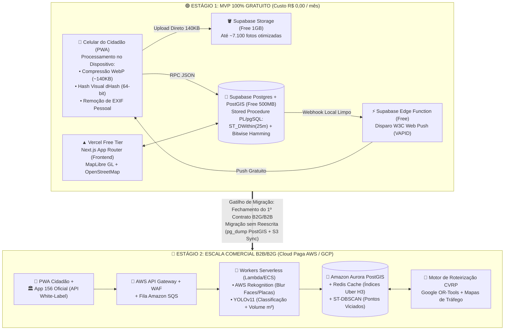
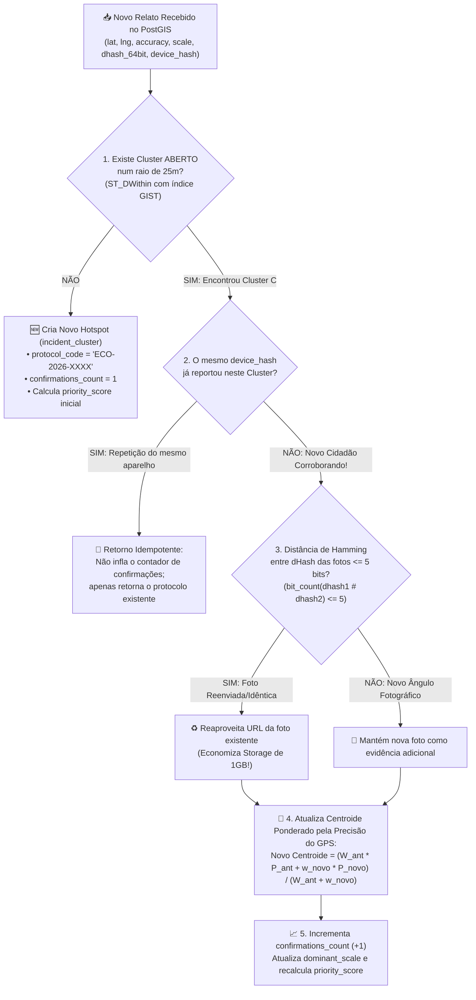

# Entregável 2: Arquitetura de Software e Engenharia de Dados (Estratégia Free $\rightarrow$ Paid)

> **Skills Acionadas e Explicitadas neste Módulo:**
> - **`senior-architect`**: Desenho de arquitetura evolutiva sem *vendor lock-in*, desacoplamento entre camada de apresentação (PWA), armazenamento de objetos (S3-compatible) e motor espacial (PostgreSQL/PostGIS).
> - **`database` (`postgresql`, `neon-postgres` / `supabase`)**: Modelagem geoespacial avançada em **PostGIS**, indexação espacial `GIST`, operações em tipos `GEOGRAPHY` e `BIT(64)`, e evolução para **Uber H3** e **ST-DBSCAN**.
> - **`aws-skills`**: Planejamento da infraestrutura de destino Enterprise (AWS S3, CloudFront, API Gateway, SQS, Lambda, Rekognition, Aurora PostgreSQL/PostGIS) para contratos B2B/B2G.
> - **`gdpr-data-handling` (Adaptado à LGPD)**: Controle de privacidade em imagens de vias públicas, anonimização criptográfica de dispositivos e ciclo de vida de dados.

---

## 1. Arquitetura Evolutiva: Do Custo Zero ($0) à Escala B2B/B2G

Para viabilizar a validação acadêmica e comunitária imediata sem custos de cartão de crédito ou mensalidades de nuvem (**Restrição Arquitetural 2**), e ao mesmo tempo preparar o produto para suportar contratos públicos com prefeituras e concessionárias (**Restrição Arquitetural 3**), desenhamos uma arquitetura em **Dois Estágios Compatíveis por Contrato**:

---

## 2. Detalhamento da Stack "Free Tier" do MVP (Por que custa R$ 0,00?)

| Componente | Ferramenta Escolhida (Free Tier) | Limite Gratuito | Como Nossa Engenharia Multiplica Esse Limite |
| :--- | :--- | :--- | :--- |
| **Hospedagem Frontend & PWA** | **Vercel (Hobby Plan)** ou **Cloudflare Pages** | 100 GB bandwidth/mês (Vercel) ou Ilimitado (Cloudflare) | Assets estáticos cacheados no Service Worker do celular do cidadão; carregamento instantâneo após o 1º acesso. |
| **Banco de Dados Geoespacial** | **Supabase Database (PostgreSQL 15 + `PostGIS`)** | 500 MB de espaço em disco + 2 GB egress | A extensão `PostGIS` já vem pré-instalada gratuitamente no Supabase. 500 MB comportam **> 500.000 relatos georreferenciados**. |
| **Armazenamento de Fotos** | **Supabase Storage** | 1 GB de objetos armazenados | O Web Worker no celular comprime fotos de `5 MB` para `~140 KB` em formato `WebP` (`1280px`). Além disso, fotos visualmente idênticas (`dHash`) reutilizam a URL existente. **Cabem > 7.100 fotos únicas gratuitamente.** |
| **Renderização de Mapas** | **MapLibre GL JS** + **OpenStreetMap / Protomaps** | **100% Gratuito e Open-Source** (Sem chave de API paga) | Ao contrário do Google Maps (que exige cartão de crédito e cobra por load), MapLibre GL renderiza tiles vetoriais via WebGL no navegador a custo zero. |
| **Geocodificação Reversa** | **Nominatim (OSM)** com Cache no PostGIS | Gratuito (respeitando 1 req/seg e cache) | Quando um Hotspot é criado, o endereço aproximado da rua é resolvido **apenas 1 vez por Cluster** (e não a cada foto repetida), salvando o resultado na tabela `incident_clusters`. |
| **Notificações "Local Limpo"** | **W3C Web Push Protocol (`web-push` + chaves VAPID)** | **Ilimitado e 100% Gratuito** | Usa os serviços nativos de push da Mozilla/Google/Apple sem intermediários pagos como OneSignal Enterprise ou SMS/Twilio. |

> [!TIP]
> **Alternativa 100% Local / Self-Hosted (Docker Compose):**
> Como todo o back-end utiliza o ecossistema aberto do PostgreSQL (`postgis/postgis:15-3.4`) e a CLI oficial do Supabase (`npx supabase start`), a equipe também pode rodar toda a nuvem localmente em Docker durante a apresentação para a banca sem depender sequer de internet externa!

---

## 3. Tratamento Espacial, Privacidade (LGPD) e Segurança de Imagens

Para atender rigorosamente à **Restrição 7 da Ficha de Desafio 09** (*"Registros com localização, imagens ou informações sobre propriedades privadas devem considerar privacidade e segurança"*) e à **LGPD**:

1. **Sanitização no Dispositivo Antes do Upload (*Client-Side Privacy Gate*):**
   - Ao re-encodar a foto em `WebP` via HTML5 Canvas no celular do cidadão, todos os metadados ocultos que poderiam expor a identidade do autor (número de série do sensor, nome do proprietário configurado no sistema operacional, histórico de edição) são eliminados antes que o pacote trafegue pela rede.
2. **Identificação Anônima Anti-Spam (`anonymous_device_hash`):**
   - Não coletamos CPF, nome, e-mail, número de telefone nem salvamos o endereço IP do morador na tabela de relatos.
   - O PWA gera localmente um identificador aleatório (`UUID v4`) combinado com um *salt* público da aplicação e envia apenas o hash irreversível `SHA-256` (`anonymous_device_hash`). Isso garante que o cidadão tenha **anonimato absoluto** perante vizinhos ou infratores, mas permite que o banco de dados impeça que um único aparelho inunde o sistema com 50 votos falsos no mesmo ponto (*Proteção Anti-Sybil*).
3. **Proteção de Terceiros e Propriedades Privadas (MVP vs. Enterprise):**
   - **No MVP (Custo Zero):** A interface da câmera aplica uma máscara visual de enquadramento (*"Fotografe apenas o resíduo na calçada/via pública"*) e pode acionar a API nativa `FaceDetector` do navegador (Chrome Android) ou `MediaPipe Face Detection` em WebAssembly no próprio celular para aplicar um borramento gaussiano (`ctx.filter = 'blur(16px)'`) sobre rostos detectados antes do upload.
   - **Na Escala Enterprise (Cloud Paga):** Todas as imagens caem primeiro em um bucket privado de quarentena (`s3-raw-quarantine`) e passam por uma função Serverless integrada ao **AWS Rekognition / GCP Cloud Vision**, que borra automaticamente **rostos humanos, placas de veículos e números de residências** antes de disponibilizar a foto no painel da prefeitura.

---

## 4. Engenharia do Algoritmo de Deduplicação Espacial e Visual

O problema central da gestora pública (*Juliana*) é que um único descarte de sofá ou entulho em uma rua movimentada gera dezenas de chamados separados nos canais tradicionais. Nossa arquitetura unifica esses relatos em tempo real através de um algoritmo híbrido **Espacial + Perceptual**.

### 4.1. Execução no Cenário Gratuito (MVP — 100% In-Database PostGIS)

No MVP, toda a lógica roda em uma única transação dentro da função `fn_submit_citizen_report` no PostgreSQL/PostGIS do Supabase, sem custo de servidores externos:

#### As 3 Equações Matemáticas Implementadas no Banco de Dados:

1. **Ponderação Inversa pela Variância do GPS (Fusão de Localização):**
   Se o Cidadão A reportou com um GPS ainda impreciso ($\text{accuracy}_A = 30\text{m} \implies w_A = 1/30^2 = 0.0011$) e o Cidadão B reportou com GPS travado ($\text{accuracy}_B = 5\text{m} \implies w_B = 1/5^2 = 0.0400$), o peso do Cidadão B é **36 vezes maior**, puxando automaticamente o pino do Hotspot para o ponto exato na calçada:
   $$w_i = \frac{1}{\max(\text{accuracy}_i, 3.0)^2}, \qquad \vec{C}_{\text{novo}} = \frac{W_{\text{acum}} \cdot \vec{C}_{\text{atual}} + w_i \cdot \vec{P}_i}{W_{\text{acum}} + w_i}$$

2. **Similaridade Visual Instantânea via Distância de Hamming (`dHash` 64-bit):**
   Dadas duas assinaturas visuais de 64 bits $H_1$ e $H_2$, o PostgreSQL calcula nativamente o número de bits divergentes usando o operador `XOR` (`#`) e `bit_count()`:
   $$D_{\text{Hamming}}(H_1, H_2) = \text{bit\_count}(H_1 \oplus H_2)$$
   Se $D_{\text{Hamming}} \le 5$ (similaridade estrutural $\ge 92\%$), o sistema identifica que se trata da mesma imagem ou exatamente do mesmo enquadramento.

3. **Cálculo de Prioridade de Despacho (`priority_score`):**
   Para ordenar a fila da gestora pública sem intervenção humana:
   $$\text{PriorityScore} = S_{\text{porte}} + 15 \cdot \ln(1 + N_{\text{confirmações}}) + B_{\text{córrego}}$$
   Onde:
   - $S_{\text{porte}} \in \{10 \text{ (Pequeno)}, 25 \text{ (Médio)}, 50 \text{ (Grande)}\}$;
   - $N_{\text{confirmações}}$ é o número de cidadãos distintos que reportaram o mesmo cluster (uso de logaritmo natural para dar forte impulso nas primeiras confirmações e evitar distorções extremas);
   - $B_{\text{córrego}} = +30$ se o ponto estiver em área crítica de margem de córrego/alagamento (`is_eco_critical = true`).

---

### 4.2. Evolução do Algoritmo na Escala Enterprise (Cloud Paga — AWS / GCP)

Quando o sistema escala para cidades inteiras com milhares de chamados diários:
1. **Particionamento Hexagonal Uber H3 (`h3-pg` / Redis):**
   - Cada coordenada é convertida em um índice **Uber H3 Resolução 10** (~15m de aresta). A busca de deduplicação consulta apenas os 7 hexágonos do anel `gridDisk(h3_index, 1)` em memória no Redis ($O(1)$), mantendo latência de $< 5\text{ms}$ mesmo com 10 milhões de registros históricos.
2. **Clusterização Histórica Densitária com `ST_ClusterDBSCAN`:**
   - Um worker noturno executa o algoritmo espacial **DBSCAN** (`ST_ClusterDBSCAN(centroid_geom, eps := 35, minpoints := 4)`) sobre todos os chamados já limpos nos últimos 6 meses.
   - **Resultado:** Descobre automaticamente os **"Pontos Viciados Crônicos"** (locais onde a prefeitura limpa na segunda-feira e o entulho volta na quinta-feira), gerando relatórios de inteligência para instalação de Ecopontos, placas de QR Code ou fiscalização ambiental.
