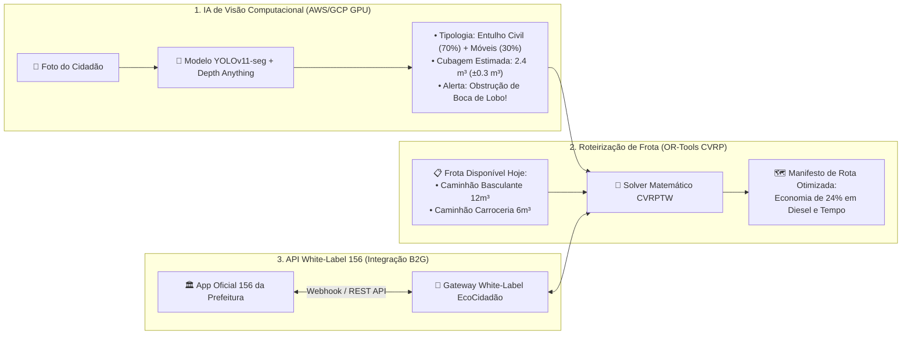

# Entregável 3: Do MVP Custo Zero ao Produto Maduro (Escopo e Escala)

> **Skills Acionadas e Explicitadas neste Módulo:**
> - **`product-manager-toolkit`**: Frameworks de priorização **RICE** e **MoSCoW**, matriz *Value vs. Effort*, definição de *North Star Metric* e alinhamento com o **Business Model Canvas** (B2B/B2G).
> - **`senior-architect`**: Arquitetura de evolução para **Visão Computacional (IA)**, **Roteirização de Frota (CVRP com OR-Tools)** e **API White-Label para o Sistema 156**.
> - **`api-patterns`**: Padrões de integração enterprise para aplicativos governamentais legados (Webhooks bidirecionais, idempotência e contratos OpenAPI).

---

## 1. Alinhamento Estratégico com a Ficha de Desafio 09 e Business Model Canvas

A **Ficha de Desafio 09** exige que o projeto demonstre:
1. Relevância do fenômeno escolhido (descarte irregular de resíduos e impacto em córregos/saúde pública);
2. Identificação clara de **quem produz o dado** (*Cidadão Marcos / Coletivos de Bairro*) e **quem utiliza o dado** (*Gestora Juliana / Secretarias de Obras / Concessionárias / Universidades*);
3. Protocolo mínimo de observação explícito, limitações e mecanismos de qualidade **sem depender obrigatoriamente de IA no início**;
4. MVP que permita testar **tanto a facilidade de participação cidadã quanto a utilidade prática do dado para o gestor**.

---

## 2. Escopo do MVP Custo Zero (O Que Codificar Agora sem Gastar R$ 0,01)

Aplicando o método **RICE (`Reach × Impact × Confidence / Effort`)** e **MoSCoW** da skill `product-manager-toolkit`, separamos rigorosamente o que é essencial para validar a proposta de valor imediatamente a custo zero:

### 2.1. Matriz de Priorização RICE & MoSCoW do MVP

| ID | Feature / Módulo | MoSCoW | Reach (Trim.) | Impact | Conf. | Effort (Semanas) | Score RICE | Status no MVP ($0) |
| :-: | :--- | :---: | :---: | :---: | :---: | :---: | :---: | :--- |
| **F1** | **Câmera PWA 3 Toques + GPS c/ Feedback de Cold Start** | **MUST** | 500 | 3x (Massive) | 100% | 1.0 | **1500** | ✅ **Entra no MVP** |
| **F2** | **Motor PostGIS de Deduplicação Espacial (Raio 25m)** | **MUST** | 500 | 3x (Massive) | 100% | 1.0 | **1500** | ✅ **Entra no MVP** |
| **F3** | **Compressão Edge WebP (~140KB) + Hash `dHash` 64-bit** | **MUST** | 500 | 2x (High) | 90% | 0.8 | **1125** | ✅ **Entra no MVP** |
| **F4** | **Painel Gestor com Mapa MapLibre + Fila de Prioridade** | **MUST** | 500 | 3x (Massive) | 90% | 1.2 | **1125** | ✅ **Entra no MVP** |
| **F5** | **Loop de Notificação Web Push "Local Limpo" (VAPID)** | **MUST** | 400 | 2x (High) | 90% | 0.8 | **900** | ✅ **Entra no MVP** |
| **F6** | **Placas Físicas de QR Code Ancorado para Pontos Crônicos** | **MUST** | 300 | 2x (High) | 100% | 0.5 | **1200** | ✅ **Entra no MVP** |
| **F7** | **Fila Offline (`IndexedDB`) para Áreas sem Sinal** | **SHOULD** | 200 | 2x (High) | 80% | 0.8 | **400** | ✅ **Entra no MVP** |
| **F8** | **Exportação de Dados Abertos (GeoJSON/CSV) p/ Pesquisa** | **SHOULD** | 150 | 2x (High) | 100% | 0.5 | **600** | ✅ **Entra no MVP** |
| **F9** | **IA Server-Side de Classificação e Volumetria 3D ($\text{m}^3$)** | **WON'T** | 500 | 2x (High) | 70% | 4.0 | **175** | ⏳ **Fase Madura (Paga)** |
| **F10** | **Roteirização Multi-Caminhão Automática (OR-Tools CVRP)** | **WON'T** | 500 | 3x (Massive) | 80% | 5.0 | **240** | ⏳ **Fase Madura (Paga)** |
| **F11** | **API White-Label Bidirecional para Apps 156 Oficiais** | **WON'T** | 500 | 3x (Massive) | 80% | 4.0 | **300** | ⏳ **Fase Madura (Paga)** |

---

### 2.2. Como o MVP Testa as Duas Pontas sem Gastar Nada

1. **Teste da Facilidade de Participação (Lado Cidadão — Marcos):**
   - Imprimimos 10 placas de QR Code em papel couchê/adesivo plastificado e fixamos em pontos críticos do bairro-piloto ou arredores da universidade.
   - **Métrica de Sucesso (Ativação):** Tempo médio entre abrir a câmera e concluir o Toque 2 deve ser **$< 20\text{ segundos}$**, com taxa de conclusão **$> 80\%$** (contra $< 15\%$ dos formulários tradicionais do 156).
2. **Teste da Utilidade e Qualidade do Dado (Lado Gestor — Juliana):**
   - Simulamos (ou executamos junto à associação de bairro/secretaria local) que 15 moradores diferentes fotografem os mesmos 3 focos de descarte.
   - **Métrica de Sucesso (Deduplicação):** O painel da gestora deve exibir **exatamente 3 Hotspots unificados** (redução de $80\%$ no ruído de triagem), ordenados pelo `priority_score` e indicando se o porte exige carrinho de mão (`SMALL`), caminhonete (`MEDIUM`) ou caminhão basculante (`LARGE`).
   - Ao clicar em **"Marcar como Limpo"** e enviar a foto do local limpo, os 15 celulares recebem a notificação Push instantaneamente.

---

### 2.3. Explicitação do Protocolo Científico, Qualidade e Limitações (Requisito 7 da Ficha 09)

Para garantir rigor metodológico de **Ciência Cidadã** (inspirado no protocolo *NASA GLOBE Observer* citado na Ficha de Desafio 09):

- **Variáveis Padronizadas Coletadas em Todo Registro:**
  1. `report_geom`: Coordenada WGS84 (`SRID 4326`) validada;
  2. `gps_accuracy_m`: Raio de incerteza métrica do receptor GNSS no instante do registro;
  3. `location_source`: Rastreabilidade da fonte (`BROWSER_GPS`, `QR_ANCHOR` ou `EXIF_GPS`);
  4. `reported_scale`: Classe volumétrica padronizada (`SMALL` $< 0.05\text{m}^3$, `MEDIUM` $0.05\text{–}1.0\text{m}^3$, `LARGE` $> 1.0\text{m}^3$);
  5. `confirmations_count`: Grau de consenso inter-observadores (quantos cidadãos independentes corroboraram a mesma observação espacial).
- **Limitações Conhecidas e Mitigações:**
  - *Cânions Urbanos e Árvores Densas:* Podem degradar o GPS do celular para `±35m`. **Mitigação:** Uso das âncoras de QR Code fixas e cálculo do centroide ponderado pelo inverso do quadrado da acurácia ($1/\text{accuracy}^2$).
  - *Subjetividade na Escolha de Porte:* Um cidadão pode classificar um sofá como "Médio" e outro como "Grande". **Mitigação:** O cluster adota a moda estatística ponderada ou o porte conservador mais alto para evitar que a prefeitura envie um veículo subdimensionado, além de exibir as fotos unificadas no painel.

---

## 3. Produto Maduro: Evolução Tecnológica e Monetização B2B/B2G (Cloud Paga)

Quando o produto avança para contratos comerciais com **Prefeituras (B2G)** e **Concessionárias de Limpeza Urbana (B2B)** — cobrando **mensalidade SaaS por tamanho de frota + taxa de setup e consumo da API White-Label** (Bloco 5 do Business Model Canvas) — a receita financia os 3 módulos avançados na AWS/GCP:

### 3.1. Módulo 1: IA de Reconhecimento de Imagem e Estimativa Volumétrica ($\text{m}^3$)
- **Problema que resolve na escala:** Eliminar até mesmo a necessidade do Toque 2 ou auditar automaticamente se o relato é válido, qual o tipo exato de caminhão/equipamento necessário e quantos metros cúbicos ($\text{m}^3$) ocupará na caçamba.
- **Arquitetura Técnica:**
  - Pipeline assíncrono no **Amazon ECS GPU / SageMaker Serverless** executando:
    1. **Classificação Multi-Label (YOLOv11):** Distingue *Resíduo de Construção Civil (RCC/Entulho)*, *Volumosos (Sofás/Colchões)*, *Resíduos Verdes (Galhos/Podas)*, *Domiciliar* e *Risco Biológico/Pneus*.
    2. **Estimativa Monocular de Profundidade e Volume (*Monocular Depth Estimation*):** Combina o mapa de profundidade (*Depth Anything v2*) com objetos de referência da via urbana (meio-fio padrão ABNT de `15cm` de altura, largura de calçada, sacos de lixo padrão `100L`) para estimar a cubagem em metros cúbicos ($\text{m}^3$).

### 3.2. Módulo 2: Roteirização Inteligente de Caminhões de Frota (CVRP)
- **Problema que resolve na escala:** Hoje os caminhões de zeladoria rodam no modelo "apaga-incêndio" em zigue-zague pela cidade ou voltam para a garagem com metade da caçamba vazia (ou precisam abortar uma coleta porque a caçamba encheu no meio do caminho).
- **Arquitetura Técnica:**
  - Microsserviço em Python usando **Google OR-Tools (Capacitated Vehicle Routing Problem with Time Windows — CVRPTW)** + matriz de distâncias viárias reais (**AWS Location Service / OSRM**).
  - **Função Objetivo:** Minimizar o custo total de deslocamento $\sum_{k \in K} \sum_{(i,j)} c_{ij} x_{ijk}$ sujeito à capacidade volumétrica $V_k$ e de peso $P_k$ de cada caminhão $k$, agrupando apenas resíduos compatíveis com aquele tipo de veículo (ex: caminhão compactador nunca recebe pontos classificados como entulho de concreto).
  - **Dashboard de ROI para Customer Success (Bloco 4 do Canvas):** Gera mensalmente para o Secretário de Obras o relatório comprovando: *"Neste mês, o algoritmo unificou 1.420 denúncias repetidas em 310 ordens de serviço reais e economizou 1.850 km de rodagem de caminhão (R$ 14.200 em óleo diesel e manutenção)"*.

### 3.3. Módulo 3: API White-Label e SDK para o App Oficial da Prefeitura (156)
- **Problema que resolve na escala:** Grandes municípios já investiram milhões em aplicativos próprios ("SP156", "1746 Rio", "Colab") e não querem divulgar uma nova marca para o cidadão, mas sofrem internamente com chamados duplicados e falta de roteirização.
- **Arquitetura Técnica (2 Formas de Integração Comercial):**
  1. **Modo Headless API (Backstage Engine):** O aplicativo 156 da prefeitura continua sendo a interface do cidadão, mas faz um `POST /v1/whitelabel/156/ingest` enviando a foto e coordenada para nossa nuvem. Nossa API devolve em `< 200ms` se aquele chamado já existe (`is_duplicate: true, master_cluster_id: "..."`) junto com a cubagem estimada pela IA e a rota sugerida para o caminhão.
  2. **Modo Micro-Frontend / WebView SDK ("Câmera Expressa 156"):** A prefeitura embute nosso fluxo de 3 toques dentro do app oficial dela usando as cores e brasão do município (*White-Label*).
