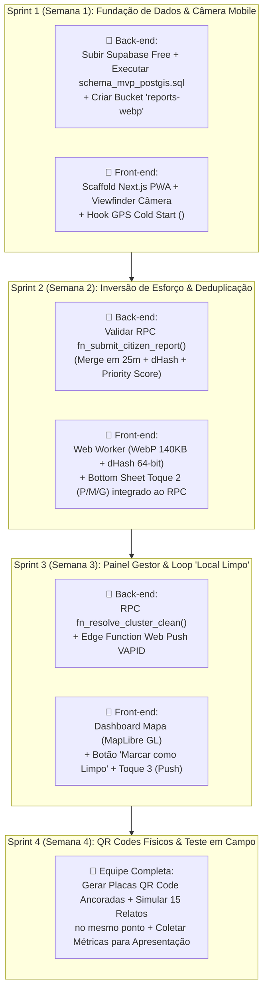
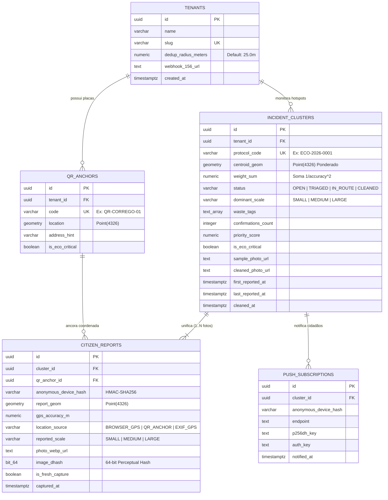

# Entregável 4: Roadmap Ágil, Divisão de Tarefas da Dupla, Functions e Banco de Dados

> **Skills Acionadas e Explicitadas neste Módulo:**
> - **`plan-writing` & `planning-with-files`**: Estruturação de cronograma enxuto orientado a entregas verificáveis e divisão clara de responsabilidades entre **Front-end (Next.js/React)** e **Back-end (Supabase/PostGIS)**.
> - **`database` (`postgresql` + `postgis`)**: Modelagem ER completa e contratos de funções espaciais `PL/pgSQL`.
> - **`api-patterns`**: Especificação dos contratos de comunicação entre o Front-end Next.js e o Back-end Supabase (RPCs, Storage Buckets e Webhooks), além dos endpoints REST `/v1` da versão Enterprise.

---

## 1. Divisão Prática de Responsabilidades na Equipe (Front-end vs. Back-end)

Para maximizar a velocidade de entrega sem conflitos de código (`merge conflicts`), o trabalho do MVP está dividido em dois contratos claros:

| Frente de Trabalho | Responsável | Escopo Técnico Principal | Arquivo-Chave de Referência |
| :--- | :--- | :--- | :--- |
| **📱 Front-end Mobile-First & PWA (Next.js / React / Tailwind)** | **Você (Front-end Lead)** | • Tela de Câmera em 3 Toques na *Thumb Zone*<br/>• Hook `useHighAccuracyGps` + Pílula visual `"🛰️ Buscando satélites..."` (*Cold Start*)<br/>• Web Worker Client-side: Compressão `WebP (~140KB)` + cálculo do `dHash (64-bit)` + leitura EXIF<br/>• Painel Web da Gestora com mapa gratuito `MapLibre GL + OpenStreetMap` | [`docs/01-concepcao-ux-mobile-first.md`](file:///home/inovia-g15/Documentos/projetos/GitHub/ProjetoEmpreendedorismo/docs/01-concepcao-ux-mobile-first.md) |
| **🐘 Back-end Geoespacial & Dados (Supabase / PostGIS / SQL)** | **Seu Colega (Back-end & Data Lead)** | • Criar projeto gratuito no Supabase e rodar o script [`database/schema_mvp_postgis.sql`](file:///home/inovia-g15/Documentos/projetos/GitHub/ProjetoEmpreendedorismo/database/schema_mvp_postgis.sql)<br/>• Configurar os Buckets públicos/autenticados no Supabase Storage (`reports-webp` e `cleaned-photos`)<br/>• Testar e expor as 3 funções RPC (`fn_submit_citizen_report`, `fn_get_active_hotspots_geojson`, `fn_resolve_cluster_clean`)<br/>• Configurar a Edge Function de Web Push (`notify-clean-loop`) | [`database/schema_mvp_postgis.sql`](file:///home/inovia-g15/Documentos/projetos/GitHub/ProjetoEmpreendedorismo/database/schema_mvp_postgis.sql) |

---

## 2. Roadmap Ágil de Desenvolvimento (4 Semanas para o MVP Gratuito + Escala)



---

## 3. Catálogo Completo de Functions e Contratos de API (Front $\leftrightarrow$ Back)

Abaixo está o contrato exato de integração para que o seu código **Next.js/React** converse perfeitamente com o **Supabase PostGIS** configurado pelo seu colega:

### 3.1. Operações do MVP (Supabase Client SDK / RPC — Custo Zero)

#### 1. Upload da Foto Otimizada (`reports-webp` Storage Bucket)
- **Quem chama:** Front-end Next.js logo após o Web Worker comprimir a foto para `~140KB WebP`.
- **Chamada no Front-end:**
  ```ts
  const fileName = `${Date.now()}-${crypto.randomUUID()}.webp`;
  const { data, error } = await supabase.storage
    .from('reports-webp')
    .upload(fileName, webpBlob, { contentType: 'image/webp', upsert: false });
  ```

#### 2. Envio de Relato com Deduplicação Espacial Automática (`rpc/fn_submit_citizen_report`)
- **Quem chama:** Front-end Next.js no **Toque 2** (assim que o cidadão escolhe `SMALL`, `MEDIUM` ou `LARGE`).
- **Endpoint HTTP Equivalente:** `POST https://<project-ref>.supabase.co/rest/v1/rpc/fn_submit_citizen_report`
- **Payload de Entrada (Request JSON):**
  ```json
  {
    "p_tenant_slug": "piloto-universidade",
    "p_lat": -23.550520,
    "p_lng": -46.633308,
    "p_accuracy_m": 6.5,
    "p_location_source": "BROWSER_GPS",
    "p_reported_scale": "LARGE",
    "p_waste_tags": ["ENTULHO", "CORREGO"],
    "p_photo_url": "https://<project>.supabase.co/storage/v1/object/public/reports-webp/foto1.webp",
    "p_image_dhash": "1011001011010100111100001010101011001100111100001010101011001100",
    "p_device_hash": "e3b0c44298fc1c149afbf4c8996fb92427ae41e4649b934ca495991b7852b855",
    "p_qr_code": "QR-CORREGO-01",
    "p_is_fresh": true
  }
  ```
- **Resposta do Banco (Response JSON — $< 20\text{ms}$):**
  ```json
  {
    "cluster_id": "a1b2c3d4-e5f6-7890-abcd-ef1234567890",
    "protocol_code": "ECO-2026-0001",
    "status": "OPEN",
    "confirmations_count": 4,
    "priority_score": 84.14,
    "is_merged_into_existing": true,
    "is_duplicate_device": false,
    "message": "Relato unificado ao Hotspot existente com sucesso!"
  }
  ```

#### 3. Listagem de Hotspots em GeoJSON para o Mapa da Gestora (`rpc/fn_get_active_hotspots_geojson`)
- **Quem chama:** Painel da Gestora (`/admin`) para desenhar os pinos e círculos de calor no `MapLibre GL`.
- **Endpoint HTTP Equivalente:** `POST https://<project-ref>.supabase.co/rest/v1/rpc/fn_get_active_hotspots_geojson`
- **Resposta (GeoJSON `FeatureCollection` nativo pronto para o MapLibre):**
  ```json
  {
    "type": "FeatureCollection",
    "features": [
      {
        "type": "Feature",
        "geometry": {
          "type": "Point",
          "coordinates": [-46.633308, -23.550520]
        },
        "properties": {
          "cluster_id": "a1b2c3d4-e5f6-7890-abcd-ef1234567890",
          "protocol_code": "ECO-2026-0001",
          "status": "OPEN",
          "dominant_scale": "LARGE",
          "confirmations_count": 4,
          "priority_score": 84.14,
          "is_eco_critical": true,
          "sample_photo_url": "https://.../foto1.webp",
          "first_reported_at": "2026-11-12T20:15:00Z"
        }
      }
    ]
  }
  ```

#### 4. Baixa de Limpeza e Disparo do Alerta "Local Limpo" (`rpc/fn_resolve_cluster_clean`)
- **Quem chama:** Gestora ou Equipe de Limpeza ao anexar a foto do local limpo.
- **Efeito:** Muda o status do cluster para `CLEANED`, salva a `cleaned_photo_url` e retorna a lista de endpoints `push_subscriptions` para disparo imediato do Web Push gratuito para todos os moradores que reportaram aquele foco.

---

### 3.2. Endpoints RESTful Adicionais da Fase Madura (Cloud Paga B2B/B2G)

| Método | Endpoint REST (`/v1`) | Consumidor | Descrição |
| :---: | :--- | :--- | :--- |
| `POST` | `/v1/ai/analyze-waste` | Worker Interno | Executa inferência YOLOv11 + Depth Estimation para classificar resíduos e estimar volume em $\text{m}^3$. |
| `POST` | `/v1/fleet/routes/optimize` | Painel Concessionária | Executa o solver **CVRP (OR-Tools)** distribuindo os Hotspots abertos entre os caminhões disponíveis no turno. |
| `GET` | `/v1/analytics/chronic-hotspots` | Secretaria de Obras | Executa `ST_ClusterDBSCAN` sobre o histórico para listar os "Pontos Viciados" recorrentes e métricas de ROI. |
| `POST` | `/v1/whitelabel/156/webhook` | App 156 Prefeitura | Integração bidirecional White-Label para sincronizar abertura e fechamento de Ordens de Serviço. |

---

## 4. Diagrama Entidade-Relacionamento (ERD) do Banco de Dados



---

## 5. Guia Rápido para Seu Colega de Back-end Subir o Banco no Supabase (5 Minutos)

Repasse estas instruções diretas junto com o arquivo [`database/schema_mvp_postgis.sql`](file:///home/inovia-g15/Documentos/projetos/GitHub/ProjetoEmpreendedorismo/database/schema_mvp_postgis.sql):

1. Acesse [https://supabase.com](https://supabase.com) e crie um novo projeto no **Free Plan ($0/mês)**.
2. No menu lateral esquerdo do painel do Supabase, clique em **SQL Editor** $\rightarrow$ **New Query**.
3. Copie todo o conteúdo do arquivo [`database/schema_mvp_postgis.sql`](file:///home/inovia-g15/Documentos/projetos/GitHub/ProjetoEmpreendedorismo/database/schema_mvp_postgis.sql), cole no editor e clique em **Run (Ctrl+Enter)**.
   - O script já ativa automaticamente a extensão `PostGIS`, cria todas as tabelas, índices espaciais `GIST`, políticas de segurança (`RLS`), as 3 funções `RPC` prontas para o Front-end consumir e ainda insere **dados iniciais de teste (Seed)**!
4. No menu lateral, clique em **Storage** $\rightarrow$ **New Bucket** e crie dois buckets marcados como **Public**:
   - `reports-webp` (para as fotos comprimidas enviadas pelos cidadãos);
   - `cleaned-photos` (para as fotos de comprovação de "Local Limpo" enviadas pela prefeitura).
5. Copie a `Project URL` e a chave `anon public` em **Project Settings $\rightarrow$ API** e envie para o Front-end colocar no `.env.local`:
   ```env
   NEXT_PUBLIC_SUPABASE_URL=https://seu-projeto.supabase.co
   NEXT_PUBLIC_SUPABASE_ANON_KEY=eyJhbGciOiJIUzI1NiIsInR5cCI6...
   ```
